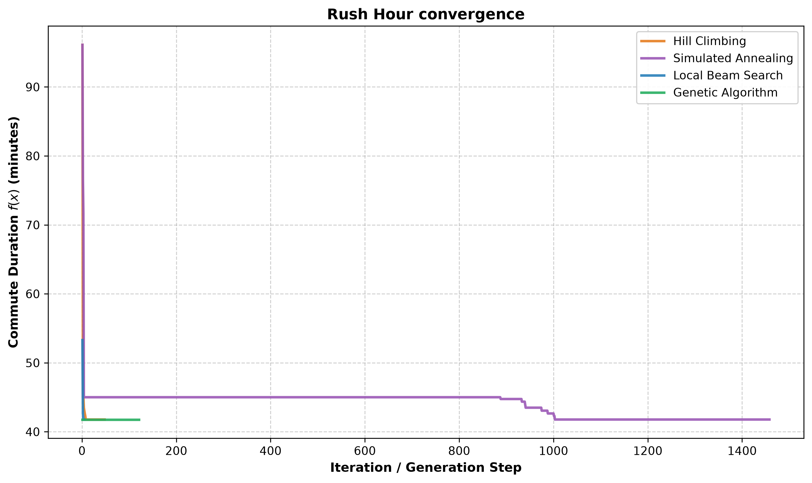
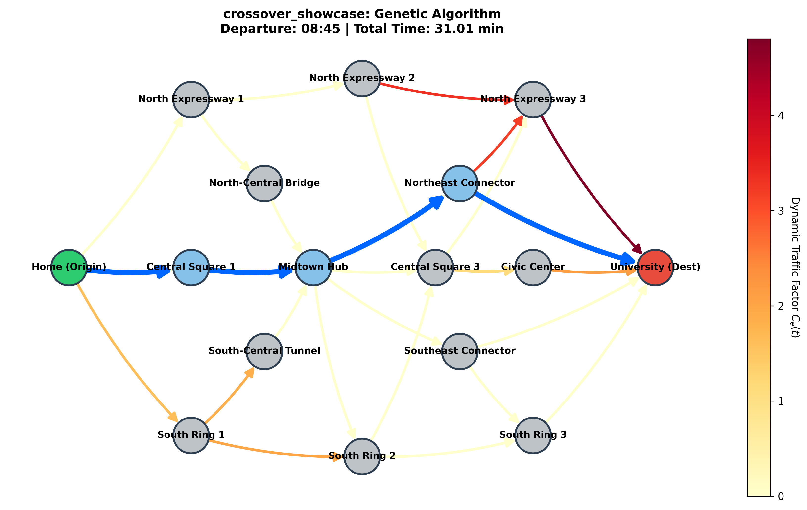
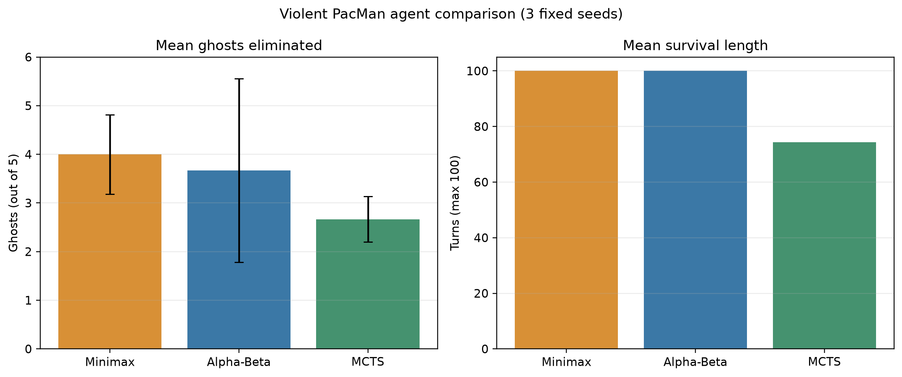
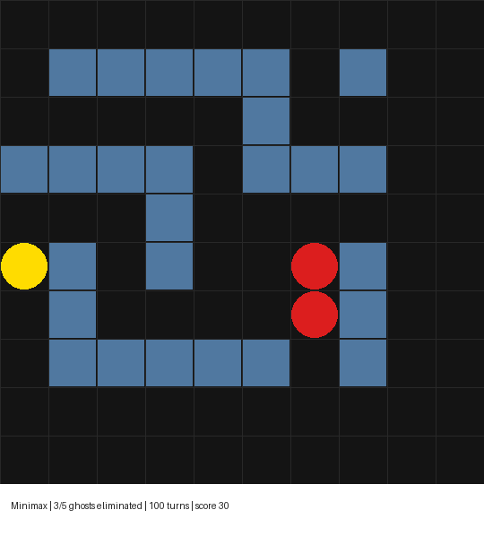

# گزارش پیاده سازی و تحلیل تمرین دوم

این گزارش پیاده سازی چهار حل گر بهینه سازی مسیر و سه عامل بازی را توضیح می دهد و نتایج اجرای آن ها را ارائه می کند. در پنج سناریوی مسیر، هر چهار حل گر در سه seed به بهترین هزینه ثبت شده یکسان رسیدند؛ در بازی PacMan، مینی ماکس میانگین ۴ روح از ۵ روح را حذف کرد و در هر سه اجرای ۱۰۰ نوبتی زنده ماند. آلفا بتا در عمق بیشتر هزینه محاسباتی بالاتری داشت و MCTS در این تنظیمات نوسان بیشتری نشان داد.

نتایج مسیر «بهترین مقدار پیدا شده» هستند و اثبات بهینگی سراسری محسوب نمی شوند. پنجره زمانی فایل config.json فقط ۰۷:۴۵ تا ۰۸:۴۵ را پوشش می دهد؛ بنابراین زمان ۰۸:۴۵ بهترین زمان در همین پنجره است، نه لزوماً در کل بازه روز.

## دامنه و روش اجرا

- سؤال اول: چهار حل گر روی پنج جفت نقشه و سناریوی تعیین شده در README اجرا شدند؛ برای هر ترکیب سه seed یعنی ۱۷، ۴۲ و ۱۰۱ به کار رفت. در مجموع ۶۰ اجرا ثبت شد.

- سؤال دوم: مینی ماکس، آلفا بتا و MCTS روی سه seed یعنی ۲۱، ۴۲ و ۷۳ و محیط ۵ روح با سقف ۱۰۰ نوبت اجرا شدند. زمان هر تصمیم نیز اندازه گیری شد.

- هسته شبیه ساز مسیر و موتور بازی دست نخورده ماندند. تغییرات به حل گرها، عملگرها، تابع ارزیابی PacMan و فایل وابستگی بازی محدود شدند.

- طبق اعلام کاربر، استاد استفاده از LLM را برای هر دو سؤال عملی مجاز کرده است. بند محدودیت AI در PDF پیوست به عنوان متن اولیه تمرین در نظر گرفته شد و این مجوز اعلام شده در بخش شفافیت ثبت شده است.

# سؤال اول بهینه سازی مسیر

## مدل حالت و عملگرها

هر حالت کامل به صورت x = (P, t_start) نگهداری می شود. تابع get_neighbors دو حرکت زمانی در همسایگی یعنی t_start ± Δt را می سازد و قطعه های کوتاه مسیر را با مسیرهای جهت دار ساده جایگزین می کند. جایگزینی فقط زمانی پذیرفته می شود که همه یال ها وجود داشته باشند، هیچ گرهی تکرار نشود و مسیر از Home شروع و به Uni ختم شود. تعداد مسیرهای detour در هر پنجره و تعداد کل همسایه ها محدود است تا زمان هر گام رشد کنترل شده داشته باشد.

عملگر crossover گره های میانی مشترک دو والد را پیدا می کند، پیشوند یک مسیر را با پسوند مسیر دیگر می چسباند و هر دو جهت اتصال را بررسی می کند. فرزند فقط پس از کنترل پیوستگی و نبود چرخه پذیرفته می شود. اگر والدها گره میانی مشترک نداشته باشند یا اتصال ها چرخه بسازند، مسیر یکی از والدهای معتبر حفظ می شود و زمان حرکت میانگین گیری و به نزدیک ترین بازه مجاز گرد می شود.

## چهار حل گر

- تپه نوردی: در هر گام کم هزینه ترین همسایه را برمی گزیند؛ حرکت هم هزینه را تا سقف max_sideways می پذیرد و مجموعه visited از چرخش روی plateau جلوگیری می کند. پس از توقف محلی، مسیر و زمان شروع تصادفی تازه ای می سازد.

- تبرید شبیه سازی شده: حرکت بهتر را همیشه می پذیرد و حرکت بدتر را با احتمال exp(-ΔE/T) قبول می کند. دما با ضریب cooling_rate کم می شود و بهترین حالت دیده شده در history ثبت می ماند.

- پرتوی محلی: همسایه های همه حالت های پرتو را در یک استخر جمع می کند، حالت های تکراری را حذف می کند و K حالت برتر را برای گام بعد نگه می دارد. هنگام انتخاب، مسیرهای متفاوت را ترجیح می دهد تا پرتو سریعاً به چند نسخه از یک مسیر تبدیل نشود.

- الگوریتم ژنتیک: جمعیتی از حالت های معتبر می سازد، والدها را با tournament انتخاب می کند، crossover و جهش را اجرا می کند و تعداد مشخصی نخبه را بدون تغییر به نسل بعد می برد.

**جدول ۱ بهترین مسیر ثبت شده در هر سناریو**

| سناریو | هزینه دقیقه | حرکت | مسیر |

| --- | --- | --- | --- |

| اوج ترافیک در گراف کوچک | 41.77 | 08:45 | Home -> B1 -> B2 -> H2 -> Uni |

| دو موج ترافیک | 31.69 | 08:45 | Home -> C1 -> C2 -> T2 -> Uni |

| قفل شدگی آبشاری | 31.02 | 08:45 | Home -> C1 -> C2 -> B2 -> Uni |

| نمایش تقاطع مسیرها | 31.01 | 08:45 | Home -> C1 -> C2 -> B2 -> Uni |

| فلات هموار مرکز شهر | 28.85 | 08:45 | Home -> G1 -> G2 -> G3 -> G7 -> Uni |

**جدول ۲ مقایسه همه حل گرها در پنج سناریو میانگین زمان و گام ها روی سه seed**

| سناریو | حل گر | بهترین دقیقه | زمان میانگین ثانیه | گام میانگین |

| --- | --- | --- | --- | --- |

| اوج ترافیک در گراف کوچک | تپه نوردی | 41.77 | 0.009 | 61.7 |

| اوج ترافیک در گراف کوچک | تبرید شبیه سازی شده | 41.77 | 0.159 | 1457.0 |

| اوج ترافیک در گراف کوچک | پرتوی محلی | 41.77 | 0.004 | 3.3 |

| اوج ترافیک در گراف کوچک | الگوریتم ژنتیک | 41.77 | 0.282 | 120.0 |

| دو موج ترافیک | تپه نوردی | 31.69 | 0.022 | 91.3 |

| دو موج ترافیک | تبرید شبیه سازی شده | 31.69 | 0.279 | 1457.0 |

| دو موج ترافیک | پرتوی محلی | 31.69 | 0.011 | 5.3 |

| دو موج ترافیک | الگوریتم ژنتیک | 31.69 | 0.410 | 120.0 |

| قفل شدگی آبشاری | تپه نوردی | 31.02 | 0.027 | 109.7 |

| قفل شدگی آبشاری | تبرید شبیه سازی شده | 31.02 | 0.283 | 1457.0 |

| قفل شدگی آبشاری | پرتوی محلی | 31.02 | 0.009 | 4.3 |

| قفل شدگی آبشاری | الگوریتم ژنتیک | 31.02 | 0.416 | 120.0 |

| نمایش تقاطع مسیرها | تپه نوردی | 31.01 | 0.026 | 106.7 |

| نمایش تقاطع مسیرها | تبرید شبیه سازی شده | 31.01 | 0.290 | 1457.0 |

| نمایش تقاطع مسیرها | پرتوی محلی | 31.01 | 0.015 | 7.3 |

| نمایش تقاطع مسیرها | الگوریتم ژنتیک | 31.01 | 0.426 | 120.0 |

| فلات هموار مرکز شهر | تپه نوردی | 28.85 | 0.015 | 96.3 |

| فلات هموار مرکز شهر | تبرید شبیه سازی شده | 28.85 | 0.195 | 1457.0 |

| فلات هموار مرکز شهر | پرتوی محلی | 28.85 | 0.010 | 7.3 |

| فلات هموار مرکز شهر | الگوریتم ژنتیک | 28.85 | 0.364 | 120.0 |

در هر سناریو، کمترین هزینه ثبت شده بین الگوریتم ها برابر بود؛ با این حال مسیرهای هم هزینه در دو سناریوی قفل شدگی آبشاری و نمایش تقاطع مسیرها متفاوت بودند. این برابری به معنی یکسان بودن روش جست وجو نیست: پرتو محلی در چند گام به حالت نهایی رسید، تبرید شبیه سازی شده طبق برنامه دما حدود ۱۴۵۷ حرکت ثبت کرد و الگوریتم ژنتیک تمام ۱۲۰ نسل تنظیم شده را اجرا کرد.

## آزمایش حساسیت پارامترها

**جدول ۳ حساسیت سه پارامتر با سه seed**

| سناریو | پارامتر | مقدار | بهترین دقیقه | زمان میانگین ثانیه | گام میانگین |

| --- | --- | --- | --- | --- | --- |

| فلات هموار مرکز شهر | حداکثر حرکت هم هزینه | 0 | 28.85 | 0.013 | 96 |

| فلات هموار مرکز شهر | حداکثر حرکت هم هزینه | 10 | 28.85 | 0.014 | 96 |

| فلات هموار مرکز شهر | حداکثر حرکت هم هزینه | 100 | 28.85 | 0.013 | 96 |

| نمایش تقاطع مسیرها | ضریب سرد شدن | 0.75 | 32.00 | 0.008 | 41 |

| نمایش تقاطع مسیرها | ضریب سرد شدن | 0.92 | 32.00 | 0.026 | 141 |

| نمایش تقاطع مسیرها | ضریب سرد شدن | 0.992 | 31.01 | 0.277 | 1457 |

| نمایش تقاطع مسیرها | ضریب سرد شدن | 0.999 | 31.01 | 0.560 | 3000 |

| نمایش تقاطع مسیرها | نرخ جهش | 0.0 | 31.01 | 0.131 | 120 |

| نمایش تقاطع مسیرها | نرخ جهش | 0.25 | 31.01 | 0.400 | 120 |

| نمایش تقاطع مسیرها | نرخ جهش | 0.6 | 31.01 | 0.792 | 120 |

در سناریوی crossover_showcase، سرد کردن سریع با α=۰٫۷۵ و α=۰٫۹۲ زود متوقف شد و هزینه ۳۲ دقیقه ماند. α=۰٫۹۹۲ هزینه ۳۱٫۰۱ دقیقه را با حدود ۰٫۲۸ ثانیه زمان میانگین به دست آورد؛ α=۰٫۹۹۹ همان هزینه را یافت اما به سقف ۳۰۰۰ تکرار رسید و حدود ۰٫۵۶ ثانیه زمان گرفت. نرخ جهش ۰٫۶ زمان را نسبت به ۰٫۲۵ تقریباً دو برابر کرد، بدون آنکه هزینه بهتر شود. در plateau، تغییر max_sideways از ۰ به ۱۰۰ هزینه یا تعداد گام ثبت شده را تغییر نداد؛ در همسایگی حالت اولیه یک حرکت هم هزینه وجود داشت، اما هم زمان یک detour با کاهش حدود ۴٫۷۹ دقیقه در دسترس بود، پس این اجرا برای بهبود به حرکت افقی نیاز نداشت.

## پاسخ تحلیلی به پرسش های README

### پرسش اول گرادیان نزولی و مسیر

مسیر P یک دنباله گسسته از شناسه گره هاست؛ تفریق برداری، طول گام یا گرادیان روی مجموعه مسیرهای مجاز تعریف طبیعی ندارد. تغییر یک گره ممکن است یال ناموجود بسازد یا چرخه ایجاد کند. اگر P ثابت بماند، t_start را می توان به صورت یک متغیر حقیقی بررسی کرد، به شرط آنکه هر C_e(t) مشتق پذیر باشد، بازه مجاز و تابع هزینه در آن پیوسته بماند و مشتق زمان ورودهای متوالی از قاعده زنجیره محاسبه شود. برای پنجره گسسته فعلی، جست وجوی همسایه زمانی یا ارزیابی همه زمان های مجاز ساده تر است؛ مدل Gaussian نیز در زمان پیوسته مشتق پذیر است.

### پرسش دوم حالت کامل در برابر جست وجوی تدریجی

زمان ورود به هر یال به زمان حرکت و همه یال های قبلی وابسته است؛ بنابراین تغییر پیشوند مسیر، زمان ورود به پسوند را عوض می کند. نمایش کامل مسیر و زمان حرکت این وابستگی را مستقیماً در تابع هدف نگه می دارد. دایکسترا برای هزینه های وابسته به زمان ذاتاً نامعتبر نیست: اگر تابع زمان ورود یال FIFO باشد، نسخه زمان مند می تواند بهینگی را حفظ کند. دشواری زمانی بیشتر می شود که FIFO نقض شود، انتظار یا پنجره های زمانی وجود داشته باشد، محدودیت های کلی مسیر اعمال شود یا حالت زمان مند بسیار بزرگ شود؛ در این حالت گسترش شبکه زمان محور هزینه حافظه و زمان را بالا می برد.

### پرسش سوم پرتو محلی و ترکیب ژنتیکی

پرتو محلی همسایه های همه حالت های فعال را رتبه بندی می کند، اما اطلاعات دو راه حل را به هم نمی آمیزد. crossover می تواند پیشوند سالم یک والد را با پسوند سالم والد دیگر از یک تقاطع مشترک ترکیب کند؛ این ترکیب ممکن است به بخشی برسد که هیچ حرکت محلی یک گامه ای به آن منتهی نمی شود. collapse در پرتو وقتی رخ می دهد که K حالت به مسیرهای مشابه ختم شوند. پیاده سازی حالت های دقیق تکراری را حذف می کند و در انتخاب اول مسیرهای متمایز را ترجیح می دهد؛ برای شبکه های بزرگ تر می توان فاصله ساختاری حداقلی یا نمونه برداری تصادفی را هم افزود.

### پرسش چهارم plateau و حرکت هم هزینه

در نقشه downtown_grid چند مسیر Manhattan تعداد گام و زمان پایه یکسان دارند و سناریوی flat_plateau روی چند یال داخلی موج ترافیک هموار می گذارد؛ در نتیجه دو detour متفاوت می توانند هزینه برابر بسازند. max_sideways اجازه می دهد از این شانه های هم هزینه عبور کنیم، و visited همراه با سقف حرکت از حلقه بی پایان جلوگیری می کند. در اجرای سه seed با پنجره زمانی فایل config، مقدار ۰، ۱۰ و ۱۰۰ هزینه ۲۸٫۸۵ دقیقه و حدود ۹۶ گام ثبت شده را تغییر نداد؛ پس این نمونه به سقف حرکت هم هزینه وابسته نبود.

### پرسش پنجم پویایی سرد کردن

دمای اولیه خیلی بالا حرکت های بد را تقریباً همیشه می پذیرد و جست وجو را به پیمایش تصادفی نزدیک می کند؛ دمای خیلی پایین از ابتدا رفتار حریصانه ایجاد می کند. α کوچک دما را سریع پایین می آورد و امکان خروج از حوضه محلی را کم می کند؛ در آزمایش α=۰٫۷۵ و ۰٫۹۲ هزینه ۳۲ دقیقه ماند. α=۰٫۹۹۲ و ۰٫۹۹۹ به ۳۱٫۰۱ رسیدند؛ مقدار ۰٫۹۹۹ تا سقف ۳۰۰۰ تکرار دما را به حد توقف نرساند، بنابراین زمان بیشتر داد بدون کیفیت بهتر.

### پرسش ششم والدهای جدا و برهم کنش ژن ها

وقتی دو مسیر هیچ گره میانی مشترک ندارند، تابع crossover هیچ نقطه اتصال فرضی نمی سازد؛ یک والد معتبر با زمان میانگین گیری شده و گرد شده به شبکه زمانی برمی گردد. فرزند نامناسب ممکن است از دو بخش خوب ساخته شود، چون بخش ها در مرز اتصال یال سازگار نداشته باشند، چرخه بسازند یا زمان ورود به موج ترافیک را تغییر دهند. این وابستگی میان بخش ها همان epistasis در نمایش مسیر است.

### پرسش هفتم کران فضای حالت

اگر N_t تعداد زمان های مجاز، L سقف تعداد گام و b را به عنوان ضریب انشعاب یکنواخت تقریبی بگیریم، برآورد شاخه ای فضای حالت برابر N_t × Σ(b^ℓ) برای ℓ از ۱ تا L است؛ این تقریب با افزایش L نمایی رشد می کند. چون b در سؤال میانگین درجه خروجی است و الزاماً کران تک تک گره ها نیست، کران سخت تر برای مسیر ساده از تعداد گره ها به دست می آید: N_t × Σ P(|V|-2, ℓ-1)، برای ℓ از ۱ تا min(L, |V|-1). حتی این شمارش در گراف متراکم انفجاری است؛ بنابراین جست وجوی کامل برای شبکه بزرگ پرهزینه می شود و روش های محلی راهکار عملی تری هستند.

## شرح فایل ها و مسیر اجرای کد سؤال اول

به درخواست کاربر، کامنت های پایتون از فایل های کد داخل بسته حذف شده اند. توضیحات طراحی و مسئولیت هر بخش در این راهنمای کد و تحلیل های بالا ثبت شده است؛ رشته های docstring و منطق اجرایی حفظ شده اند.

- core/state.py: شیء State یک راه حل را به شکل مسیر گره ها و زمان حرکت نگه می دارد؛ format_time فقط نمایش دقیقه را خواناتر می کند.

- core/graph.py و core/congestion.py: RoadNetwork گره ها، یال های جهت دار و زمان پایه را می خواند؛ GaussianPeakCongestion ضریب تأخیر هر یال را در زمان ورود محاسبه می کند.

- core/problem.py: CommuteProblem مسیر و حالت را اعتبارسنجی می کند، زمان حرکت را روی یال های مسیر جلو می برد و هزینه کل رسیدن را برای مقایسه حالت ها می سازد.

- algorithms/operators.py: random_state جواب اولیه می سازد؛ get_neighbors تغییر زمان و detourهای ساده را تولید می کند؛ crossover دو والد را از گره مشترک ترکیب می کند و در حالت اتصال نامعتبر به والد معتبر برمی گردد.

- algorithms/hill_climbing.py: solve بهترین همسایه را می گیرد، حرکت هم هزینه را با سقف و visited کنترل می کند و بعد از گیرکردن restart می کند.

- algorithms/simulated_annealing.py: solve حرکت بدتر را با احتمال متروپولیس می پذیرد و دما را کاهش می دهد؛ جدا نگه داشتن بهترین حالت باعث می شود افت موقت کیفیت جواب نهایی را خراب نکند.

- algorithms/beam_search.py: solve فرزندان همه اعضای پرتو را جمع می کند، تکراری ها را کنار می گذارد و K حالت مناسب و تا حد امکان متنوع را حفظ می کند.

- algorithms/genetic_algorithm.py: solve جمعیت را مقداردهی می کند، والدهای tournament را می گیرد، جهش و crossover را اعمال می کند و نخبه ها را بدون تغییر نگه می دارد.

- main.py: main آرگومان ها و seed را می خواند؛ build_problem نقشه، سناریو و محدودیت زمان را بارگذاری می کند؛ execute_solver هزینه، زمان اجرا و تاریخچه همگرایی را برای رسم و گزارش برمی گرداند.

جریان داده چنین است: main.py فایل های JSON را به شبکه و مدل ترافیک تبدیل می کند؛ CommuteProblem حالت های کامل را می سنجد؛ حل گر با عملگرهای مشترک حالت های بعدی را می سازد؛ کمترین هزینه و history در پایان برای نمودار مسیر و نمودار همگرایی استفاده می شود.

---

# سؤال دوم بازی Violent PacMan

## تابع ارزیابی و جست وجو

تابع evaluate_state برای زنده ماندن، حذف روح ها، امتیاز واقعی بازی، مهمات، پیشرفت تا مهمات بعدی و آزادی حرکت وزن می گذارد. فاصله تا روح ها با BFS و با درنظرگرفتن دیوارها محاسبه می شود؛ روح های FOLLOW و LOOKAHEAD خطر بیشتری از RANDOM می گیرند. پایان با مرگ بازیکن جریمه سنگین دارد و امتیاز مرگ به تعداد نوبت های زنده ماندن حساس است تا rolloutهای محدود بتوانند بقا را از هم تفکیک کنند.

- مینی ماکس: در گره MAX بیشترین ارزیابی و در گره MIN کمترین ارزیابی را انتخاب می کند. ترتیب حرکت ها برای هر دو الگوریتم یکسان است تا در عمق برابر tie-break یکسان بماند.

- آلفا بتا: همان بازگشت مینی ماکس را با کران های α و β اجرا می کند و پس از بی اثر شدن شاخه، ادامه آن را هرس می کند. ترتیب حرکت ها از ارزیابی یک گامه برای شروع با حرکت های امیدوارکننده استفاده می کند.

- MCTS: درخت را با UCB1 انتخاب می کند، یک حرکت را گسترش می دهد، rollout تصادفی متمایل به بقا و شلیک های برخوردکننده اجرا می کند و امتیاز را تا ریشه پس می برد. برای جلوگیری از شلیک بی هدف، ریشه با ارزیابی یک گامه مرتب می شود.

در موتور بازی، game.step هم حرکت بازیکن و هم حرکت خودکار روح ها را انجام می دهد. بنابراین MIN در این پیاده سازی یک تقریب آموزشی است که در نوبت بعدی بدترین اکشن بازیکن را برای او انتخاب می کند؛ این درخت دقیقاً مدل تصمیم های مستقل روح ها نیست. شبیه سازی مینی ماکس با seed پایدار بر اساس حالت و اکشن انجام می شود تا مقدار یک شاخه در دو الگوریتم قابل مقایسه باشد.

**جدول ۴ نتیجه سه اجرای ۱۰۰ نوبتی برای هر عامل**

| عامل | روح حذف شده از ۵ | امتیاز | نوبت میانگین | بقای ۱۰۰ نوبت | زمان جست وجو ثانیه در بازی | بیشترین تصمیم ثانیه |

| --- | --- | --- | --- | --- | --- | --- |

| مینی ماکس | 4.00 ± 0.82 | 40.0 | 100.0 | 3/3 | 6.26 | 0.409 |

| آلفا بتا | 3.67 ± 1.89 | 36.7 | 100.0 | 3/3 | 19.22 | 0.579 |

| جست وجوی درختی مونت کارلو | 2.67 ± 0.47 | 26.7 | 74.3 | 2/3 | 17.10 | 0.393 |

مینی ماکس در عمق ۳ میانگین ۴ روح را حذف کرد و هر سه seed را تا ۱۰۰ نوبت زنده ماند. آلفا بتا در عمق ۴ میانگین ۳٫۶۷ روح را حذف کرد، اما در seed سوم فقط یک روح کشت؛ اختلاف پراکندگی نشان می دهد نتیجه به نقشه و رفتار تصادفی روح ها حساس است. MCTS میانگین ۲٫۶۷ روح را حذف کرد و دو بازی از سه بازی را تا سقف نوبت ادامه داد. این مقایسه عمق برابر نیست: آلفا بتا یک ply عمیق تر تنظیم شده، بنابراین زمان بیشتر آن را نمی توان فقط به هزینه خود هرس نسبت داد.

در یک بررسی کنترل شده با عمق ۲ برای هر دو الگوریتم روی seed ۲۱، مینی ماکس و آلفا بتا حرکت و نتیجه یکسانی داشتند: ۳ روح حذف شده از ۵ و بقا تا ۶۰ نوبت. زمان کل جست وجو در همان بازی تقریباً ۱٫۱۵ ثانیه برای مینی ماکس و ۱٫۰۴ ثانیه برای آلفا بتا بود. در benchmark نهایی، بیشترین زمان یک تصمیم ۰٫۵۸ ثانیه ثبت شد که از محدودیت ۵ ثانیه کمتر است؛ اندازه گیری مستقیم زمان تابع عامل است و سربار ساخت فرایند wrapper در آن منظور نشده است.

## شرح توابع اصلی کد سؤال دوم

- student_assignment.py / evaluate_state: فاصله های BFS با لحاظ دیوار، تهدید روح ها، تعداد روح های حذف شده، امتیاز، مهمات و آزادی حرکت را به یک امتیاز واحد تبدیل می کند تا همه روش های جست وجو یک معیار داشته باشند.

- _deterministic_successors: حالت فعلی را کپی می کند و برای هر عمل بازیکن گذار قابل تکرار می سازد؛ این کار باعث می شود Minimax و Alpha-Beta در عمق برابر یک درخت یکسان ببینند و نتایج قابل مقایسه باشند.

- minimax_agent و _minimax: عامل حالت را ارزیابی می کند، در لایه های متناوب بیشینه و کمینه می گیرد و در عمق صفر یا حالت پایانی مقدار evaluate_state را برمی گرداند.

- alphabeta_agent و _alphabeta: همان انتخاب بازگشتی را با کران های alpha و beta اجرا می کنند؛ وقتی ادامه یک شاخه دیگر نمی تواند تصمیم ریشه را تغییر دهد، آن شاخه هرس می شود.

- MCTSNode و ucb1_score: هر گره وضعیت ذخیره شده، حرکت ورودی، شمار بازدید و مجموع پاداش را نگه می دارد؛ UCB1 میان آزمودن حرکت های کمتر دیده شده و بهره بردن از حرکت های موفق تعادل می گذارد.

- mcts_agent همراه _mcts_select، _mcts_expand، _mcts_simulate و _mcts_backprop: به ترتیب مسیر درخت را انتخاب، یک عمل را گسترش، rollout کوتاه را اجرا و نتیجه را تا ریشه پخش می کند؛ سپس عملی را برمی گزیند که آمار جست وجو پشتیبانی می کند.

- _timed، _worker و evaluate_agent: اجرای عامل را زیر محدودیت زمانی محافظت و نتایج چند episode را خلاصه می کنند؛ run_agent_in_window همان عامل را به رابط بازی متصل می کند.

- game.py موتور و قوانین محیط است: مشاهده، دیوارها، حرکت، شلیک، رفتار خودکار روح ها و امتیاز را فراهم می کند. عامل ها فقط از API آن استفاده می کنند و قوانین بازی را تغییر نمی دهند.

ترتیب نوبت مهم است: انتخاب عامل از مشاهده فعلی شروع می شود؛ شبیه سازی گذار بازی برای سنجش گزینه ها به کار می رود؛ عامل یک Action برمی گرداند؛ سپس موتور اصلی بازی آن را اجرا می کند و مشاهده تازه به عامل می رسد. در این نسخه، لایه MIN یک تقریب رقابتی روی عمل های بازیکن در نوبت بعدی است، نه مدل دقیق تصمیم گیری مستقل هر روح؛ این محدودیت در تفسیر نتیجه ها لحاظ شده است.

## جمع بندی و حدود نتایج

چهار حل گر مسیر از نظر بهترین هزینه های ثبت شده روی مجموعه سناریوهای ارائه شده به نتیجه یکسان رسیدند، اما زمان همگرایی و مسیرهای هم هزینه متفاوت بود. در بازی، مینی ماکس در این نمونه های محدود بهترین میانگین حذف روح را داشت؛ آلفا بتا عمق بیشتری را پوشش داد ولی زمان بیشتری مصرف کرد و نتیجه آن میان seedها نوسان داشت؛ rollout تصادفی MCTS در تنظیم فعلی عملکرد ضعیف تری داشت. برای نتیجه آماری قوی تر باید تعداد seedها افزایش یابد و عمق دو جست وجوی درختی یکسان شود.

پوشش گزارش عملی است: پرسش های نظری ابتدای PDF درباره ۱۰۰ وزیر، الگوریتم ژنتیک و درخت بازی در این فایل حل نشده اند؛ تمرکز مطابق درخواست کاربر روی دو سؤال عملی بوده است.

## شفافیت استفاده از هوش مصنوعی

کاربر اعلام کرد استاد اجازه استفاده از LLM را برای همه بخش های عملی داده است. ابزار برای پیاده سازی حل گرها و عوامل، رفع خطاهای اجرایی، اجرای benchmark و نگارش تحلیل استفاده شد. خلاصه درخواست ثبت شده این بود: «سؤال های عملی اول و دوم را طبق README و PDF کامل پیاده سازی کن، اجرا بگیر، خروجی ها را تحلیل کن و تصویرها را در گزارش فارسی بگذار.» کد و نتایج پیش از تهیه گزارش در محیط اجرا شدند؛ انتخاب seedها و محدودیت های مقایسه در متن مشخص شده اند.

